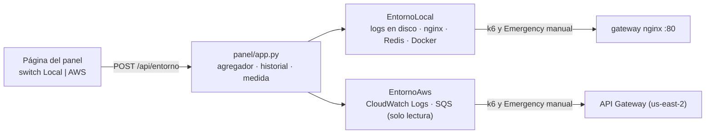

# Panel: switch Local ↔ AWS (12/10/2026)

> **Tipo:** diseño propio del equipo (Danny, con asistencia de IA). No es material oficial.
> **Fuente de la opción B:** `Modulo 2/Aportes/camilo/m2-aws-opcion-b-camilo/arquitectura-aws-opcion-b.md` §7 y §9.

## Qué resuelve

El panel observaba solo el sistema local (logs en disco, Redis, Docker). La opción B de Camilo
corre en AWS (API Gateway → Lambda → SQS → Lambda → SES). El switch del encabezado («Local ·
Docker» / «AWS · nube») cambia **qué se observa y contra qué se dispara**, sin tocar el plano de
datos de ninguno de los dos ni reescribir el panel.

## Cómo funciona



- **La pieza que lo hace barato:** las Lambdas de Camilo escriben las *mismas* líneas JSON que el
  sistema local (`EVENT_RECEIVED`, `EMERGENCY_RECEIVED`, `EMAIL_SENT`…). El agregador, la medida de
  la rúbrica, el historial y la página no cambian; solo cambia de dónde vienen las líneas
  (`panel/entornos.py`, `panel/aws.py`).
- Al cambiar de entorno se reinicia la ventana observada: lo de un entorno no se mezcla con el otro.
  El historial conserva las corridas de ambos (columna «Entorno») y cada corrida descarga sus
  logs del entorno donde corrió.
- No se puede cambiar con una carga en curso (409).

## Cómo activarlo

1. Pedir a Camilo (dueño de la cuenta) un usuario IAM **de solo lectura** con esta política:

   ```json
   {
     "Version": "2012-10-17",
     "Statement": [
       {"Effect": "Allow", "Action": "logs:FilterLogEvents",
        "Resource": ["arn:aws:logs:us-east-2:<cuenta>:log-group:/aws/lambda/reto2-ingesta:*",
                     "arn:aws:logs:us-east-2:<cuenta>:log-group:/aws/lambda/reto2-notifier:*"]},
       {"Effect": "Allow", "Action": "sqs:GetQueueAttributes",
        "Resource": ["arn:aws:sqs:us-east-2:<cuenta>:reto2-emergencias",
                     "arn:aws:sqs:us-east-2:<cuenta>:reto2-emergencias-dlq"]}
     ]
   }
   ```
2. `cp .env.aws.example .env.aws` y llenar la URL del API Gateway, las URLs de las colas y las
   credenciales. `.env.aws` está en `.gitignore`.
3. `docker compose --profile dev --profile panel up -d --build panel`.
4. Sin `.env.aws`, el switch de AWS aparece deshabilitado y su tooltip dice qué falta.

## Qué cambia en AWS (y por qué)

| En el panel | Local | AWS | Motivo |
|---|---|---|---|
| Eventos | logs en disco, en vivo | CloudWatch Logs, **~5 s de retraso** | CloudWatch publica con retraso y cada grupo va a su ritmo: el lector retiene lo más reciente para no procesar un `EMAIL_SENT` antes que su `EMERGENCY_RECEIVED` |
| Peticiones por segundo | log de nginx | derivadas de las líneas de la ingesta | API Gateway no escribe en los logs de Lambda |
| Rechazadas (429) | se cuentan | **n/d** | el 429 lo responde API Gateway y nunca llega a la Lambda |
| Medida de la rúbrica | última petición vista por nginx → último `EMAIL_SENT` | última petición vista por la Lambda de ingesta → último `EMAIL_SENT` | unos ms de diferencia con el envío de k6; declarado en el tooltip |
| Réplicas de la ingesta | contenedores | instancias de Lambda (log streams) | evidencia del número de instancias |
| Cola | Redis (pendientes sin ACK, DLQ) | SQS (en vuelo, DLQ) | mismo formato |
| Inyectar fallas | sí | oculto | el usuario IAM es de solo lectura |
| Borrar datos | historial local, logs, Redis | solo historial de AWS | CloudWatch y SQS no se tocan |

## Riesgos y límites

- **Verificado contra la cuenta real (12/10/2026, 22:49).** Usuario `user-boto3-solo-lectura` con la
  política inline `Reto2-SoloLecturaLogsYColas` (la de arriba). Lee los dos grupos de logs y las dos
  colas; listar Lambdas, buckets de S3 u otro grupo de logs da `AccessDenied`. Un Emergency manual
  (`PNL-278`) respondió 200 por API Gateway y el panel lo mostró recibido → encolado (+362 ms) →
  correo enviado (+2019 ms), leído de CloudWatch. La DLQ tenía 4 mensajes de pruebas anteriores de
  Camilo.
- **Corridas completas desde el panel (12/10/2026, 22:55, sin calentador):**

  | # | Modo | Peticiones | Fallos | p95 | Emergency | Medida (última petición → correo) | Instancias |
  |---|---|---|---|---|---|---|---|
  | 4 | k6 del profesor | 1000 (45,7 r/s) | 0 % | 120,5 ms | **0** (defecto conocido del script) | — | 8 |
  | 5 | Ritmo | 769 | 0 % | 118,2 ms | 0 (se cortó a los 30 s) | — | 6 |
  | 6 | Ráfaga, 1 Emergency | 1000 (87,1 r/s) | 0 % | 120,8 ms | 1, `VFH-999` | **1,352 s** (2,5 pts); recepción → `EMAIL_SENT` 1,602 s | 9 |

  El panel contó desde CloudWatch las mismas 1000 peticiones que k6, y la descarga de la corrida 6
  trae las 1003 líneas (999 `EVENT_RECEIVED` + el recorrido del Emergency).
  **Hallazgo:** «Ritmo» (pausa de 0,28 s) se calibró para la latencia local (~2 ms). En AWS cada
  petición ya tarda ~108 ms, así que no termina en 30 s. En AWS se usa «Ráfaga» o el k6 del profesor.
  Con 10 VUs nunca hay más de 10 peticiones en vuelo, así que la ráfaga no provoca throttling.
- **Probado también con dobles** de CloudWatch y SQS (`tests/panel/test_aws.py`, `test_app_entornos.py`).
- **Cuota de FilterLogEvents**: es baja por cuenta y región (*Probable*: del orden de unas pocas
  llamadas por segundo). El panel consulta como mucho cada 2 s por grupo. Si aparece
  `ThrottlingException`, subir `intervalo_s` en `LectorCloudWatch`.
- **Costo**: cada corrida lanzada desde el panel son 1000 peticiones reales a la cuenta de Camilo
  (API Gateway + Lambda + logs). Bajo, pero no cero. Antes de medir, activar el calentador del
  notifier y apagarlo al terminar (§9, paso 4, del aporte de Camilo).
- **Hallazgo:** con la corrección del 11/10, la concurrencia reservada quedó en 10 (ingesta) + 2
  (notifier) = 12, por encima del límite de ≤ 10 instancias del enunciado. El panel lo muestra;
  la decisión es del equipo.

## Mejora futura

Activar el *access logging* del stage `prod` de API Gateway hacia CloudWatch. Con eso el panel
podría contar los 429 y la hora exacta de cada petición, igual que con nginx (una fuente más en
`EntornoAws`).
