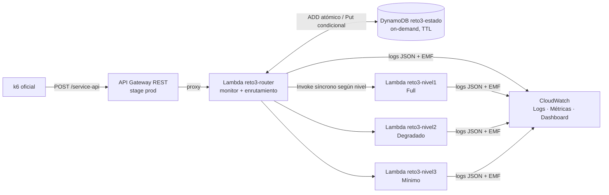

# Reto 3: arquitectura resiliente con degradación en 3 niveles (diseño)

> **Autor:** Daniel Mazo Serna (Danny), con IA. **Fecha:** 2026-10-18. **Estado:** borrador para revisión del equipo.
> **Tipo:** `investigacion` / diseño propio, **no es material oficial**. **Módulo:** 3. **Cierre del módulo:** 03/11/2026.
> **Fuentes:** `Modulo 3/Material-Clase/Actividad-Reto3.md` (enunciado) · `k6-script-profesor-reto3.js` ·
> `Discord-Aclaraciones-Docente.md` (respuestas del docente y diagrama de la sesión) · `Modulo 2/Material-Clase/Tacticas-Disponibilidad.md`
> (nombres de las tácticas) · feedback oficial del M1 (argumentación arquitectónica).

Etiquetas: **[Curso]** lo dice el material o el docente · **[Complementario]** conocimiento externo ·
**[Decisión]** recomendación nuestra como arquitectos · **[Supuesto]** falta información.

---

## 1. Problema y criterio de éxito

Sistemas UltraSeguros falla bajo carga. Hay que construir en **AWS** **[Curso]** un sistema que:

- se **degrade** automáticamente (N1 Full → N2 Degradado → N3 Mínimo) cuando crecen los errores, y se
  **recupere gradualmente** cuando la salud vuelve;
- **registre** cada cambio de nivel en logs y métricas;
- con el **k6 oficial sin modificar** (salvo la URL), **recorra los 3 niveles y termine en N1**.

**Criterio de éxito verificable:** al correr el k6 oficial contra el despliegue, los logs de k6 muestran N1, N2 y N3,
y la iteración 140 responde `Nivel 1: OK`. El log del servidor muestra cada `CAMBIO_NIVEL` con su motivo.

**Hilo conductor para la presentación:** *«Priorizamos la **disponibilidad**, porque un servicio financiero tiene que
responder siempre aunque sea con menos capacidades. Lo pagamos con funcionalidad en N2 y N3 y con algunos
milisegundos de latencia para consultar el estado compartido.»* **[Decisión]**

## 2. Restricciones

| Restricción | Origen |
|---|---|
| Solo servicios de AWS | **[Curso]** enunciado |
| Sin plantilla inicial; construir desde cero | **[Curso]** enunciado |
| No modificar el script de k6 (solo apuntar la URL a nuestro API; lo declaramos, como en el M2) | **[Curso]** enunciado |
| API Gateway como punto de entrada que enruta por nivel; 3 servicios, uno por nivel | **[Curso]** requerimientos técnicos |
| Mensajes de N3 exactos: «Nivel 3: Operación al mínimo» / «Nivel 3: Sistema bajo mantenimiento, intente más tarde» | **[Curso]** enunciado |
| La cuenta AWS es de Camilo; Danny no puede usar la suya ni los perfiles corporativos de Komet | **[Decisión]** del equipo |
| Hay que desarrollar sin una cuenta AWS disponible desde el inicio | contexto → LocalStack (§8) |
| Entrega: ZIP + PDF + video MP4 de 5 min como máximo, antes del 03/11 | **[Curso]** |

## 3. La regla de niveles

**Fuente principal:** respuesta del docente del 17/09/2026: «se cuentan los errores del minuto que ya pasó para
determinar la respuesta del minuto actual». Es coherente con el diagrama de la sesión (`Discord-Aclaraciones-Docente.md` §3 y §5). **[Curso]**

Definiciones:

- **Minuto** = minuto de reloj UTC (`floor(epoch / 60)`). El k6 espera al segundo 00 para alinearse. **[Curso]**
- **Error** = petición cuya respuesta del servicio de nivel es 5xx, o cuya invocación falla o se agota (timeout).
  Con el k6, eso equivale a `error: true` en el payload. Contamos **la salud observada, no el flag del cliente**:
  si un servicio de nivel falla de verdad, también cuenta. **[Decisión]**
- `objetivo(e) = N3 si e ≥ 10; N2 si e ≥ 5; si no, N1`. Los umbrales se configuran con variables de entorno.

**Regla (se evalúa una sola vez por minuto, con la primera petición del minuto *m*):**

```
nivel(m) = max( objetivo(errores(m-1)), nivel(m-1) - 1 )     con nivel mínimo N1
```

- **Degradación inmediata:** si el minuto anterior tuvo 10 o más errores, se pasa a N3 aunque se venga de N1.
  Así lo dijo el docente («se pasa de inmediato»). **[Curso]**
- **Recuperación escalonada:** se mejora **como máximo un nivel por minuto** (N3 → N2 → N1). Lo exige el texto del
  enunciado («desde Nivel 3 … transiciona a Nivel 2; desde Nivel 2 … a Nivel 1») y evita el salto de 3 a 1 que el
  docente llamó «problema del sistema». **[Decisión]** sobre una contradicción del docente: **[Supuesto]** que se confirma el 27/10.
- **Minutos sin tráfico** cuentan como 0 errores. La regla se aplica minuto a minuto, y como la recuperación es de
  un nivel por minuto, a los 2 minutos sanos ya se está en N1, así que el ciclo tiene como máximo 2 pasos.
- El minuto en curso no cambia de nivel, aunque acumule errores. Esto es lo que dijo el docente.

**Verificación contra el diagrama de la sesión (0 / 5 / 10 / 5 / 0 / 0 errores):** da N1, N1, N2, N3, N2, N1, igual
al diagrama. ✅

**Simulación del k6 oficial** (5 / 0 / 15 / 0 / 15 / 0 / 0 errores por minuto lógico; `scratchpad/sim.py` de la sesión,
que se convierte en un test):

| Tiempo por iteración (3 s + latencia) | Secuencia | Final |
|---|---|---|
| 3,00 s | 1-2-1-3-2-3-2 | ⚠️ N2 |
| 3,05–3,30 s | 1-2-1-3-2-3-2-1 | ✅ N1 |
| 3,50 s | 1-2-1-3-2-1 | ✅ N1 |
| 4,00 s | 1-2-1-2-3-2-3-2-1 | ✅ N1 |

**Riesgo R1:** si la latencia media cae por debajo de unos 50 ms, la prueba termina en N2. Con API Gateway, 2 Lambdas
y DynamoDB se esperan entre 50 y 150 ms. **[Supuesto]** que se mide en la primera corrida (§10).

**Respuestas** (cuerpo `{"message": "..."}`, como en las capturas oficiales):

| Nivel | Éxito | Falla |
|---|---|---|
| N1 | 200 `Nivel 1: OK` | 500 `Nivel 1: Operación Full con Error` |
| N2 | 200 `Nivel 2: OK` | 500 `Nivel 2: Operación Limitada` |
| N3 | 200 `Nivel 3: Operación al mínimo` | 503 `Nivel 3: Sistema bajo mantenimiento, intente más tarde` |

Los mensajes de N1 y N2 salen de las capturas oficiales. Los de N3, del texto del enunciado **[Curso]**. El 503 en N3
es una decisión nuestra: es el código HTTP semántico de «mantenimiento». **[Decisión]**

## 4. Arquitectura



### Componentes y responsabilidades

| Componente | Responsabilidad | Por qué este servicio |
|---|---|---|
| **API Gateway REST** | Punto de entrada único, *throttling* por stage, HTTPS | Lo exige el enunciado. Usamos REST y no HTTP API porque REST corre en LocalStack community y permite *throttling* por método **[Decisión]** |
| **`reto3-router`** | Decide el nivel del minuto, invoca el servicio de ese nivel, cuenta el resultado y registra las transiciones | El API Gateway no puede enrutar de forma nativa según un estado en DynamoDB. El patrón *Gateway Routing* deja el enrutamiento en una función detrás del gateway **[Complementario]** |
| **`reto3-nivel1`** | Full: valida, registra la transacción, análisis de riesgo, notificación (capacidades simuladas y registradas en el log) | «3 servicios diferentes por nivel» **[Curso]**. Cada servicio se despliega y escala por separado |
| **`reto3-nivel2`** | Degradado: solo valida y registra (lo esencial); el análisis y la notificación quedan diferidos | Degradación agraciada **[Curso]** |
| **`reto3-nivel3`** | Mínimo: no procesa; responde el mensaje de mantenimiento | Mantiene el servicio respondiendo **[Curso]** |
| **DynamoDB `reto3-estado`** | Estado compartido entre todas las instancias de Lambda | Las Lambdas no comparten memoria. La oscilación N3↔N1 de las capturas oficiales parece un estado no compartido **[Supuesto]** |
| **CloudWatch** | Logs estructurados, métricas EMF, dashboard | Lo exige el enunciado; EMF no necesita llamadas extra a la API **[Complementario]** |
| **SAM (CloudFormation)** | Toda la infraestructura como código, dentro del ZIP | En el M2 la configuración hecha en la consola quedó como brecha **[Decisión]** |

### Modelo de datos (tabla `reto3-estado`, clave de partición `pk`)

| Ítem | Atributos | Escritura |
|---|---|---|
| `MIN#<epochMin>` | `errores` (N), `peticiones` (N), `nivel` (N), `ttl` | `ADD` atómico de contadores; `nivel` con `attribute_not_exists(nivel)` (gana el primero que escribe) |
| `ESTADO` | `ultimo_minuto` (N), `nivel` (N) | `Put` condicional `ultimo_minuto < :m` |

`ttl` = 24 h para que la tabla no crezca.

### Flujo de una petición (router)

1. `m = minuto_actual()`. Se lee `MIN#m` con lectura consistente. Si ya tiene `nivel`, se usa.
2. Si no tiene: se lee `ESTADO` y `MIN#(m-1)`, se aplica la regla del §3 y se escribe `nivel` en `MIN#m` de forma
   condicional. Si se pierde la carrera, se relee el nivel del ganador. Luego se actualiza `ESTADO`. Si el nivel
   cambió, se emite el log `CAMBIO_NIVEL`.
3. Se invoca `reto3-nivel{n}` con el payload (timeout de cliente de 2 s, `total_max_attempts = 1`). Así no hay
   reintentos ocultos de botocore: es la lección del M2.
4. Si la respuesta es 5xx o la invocación falla, se hace `ADD errores :1` en `MIN#m`. Siempre se hace `ADD peticiones :1`.
5. Se responde al API Gateway con el `statusCode` y el `body` del servicio.

### Manejo de fallas propias

| Falla | Comportamiento | Táctica |
|---|---|---|
| DynamoDB no responde | Se responde como N3 (503 de mantenimiento) y se registra `ESTADO_NO_DISPONIBLE`; no se cuenta | Falla segura / degradación **[Decisión]** |
| La Lambda de nivel falla o se agota | Se responde 503 con el mensaje de N3 y **se cuenta como error** | Detección de excepciones (timeout) |
| Dos peticiones calculan el nivel a la vez | La escritura condicional deja un solo ganador y las dos usan el mismo nivel | Estado compartido consistente |

## 5. Atributos de calidad priorizados

1. **Disponibilidad** (principal). Escenario: *en operación normal, si en un minuto se producen 10 o más fallas,
   el sistema sigue respondiendo el 100 % de las peticiones, en N3, desde el minuto siguiente, y vuelve a N1 en 2
   minutos sin errores.* **[Decisión]**
2. **Observabilidad / auditabilidad** (requisito explícito del enunciado): cada transición queda en el log con su motivo.
3. **Modificabilidad**: los umbrales y la ventana se configuran sin desplegar código nuevo, porque el docente
   todavía puede aclararlos.

**Lo que sacrificamos, de forma explícita:** funcionalidad en N2/N3, latencia (2 llamadas a DynamoDB y 1 invocación
extra por petición, del orden de decenas de ms; **[Supuesto]** que se mide), y **reacción**: la degradación llega
al minuto siguiente, no al instante. Es lo que pide el docente y se paga con hasta 60 s de exposición.

## 6. Tácticas (nombres del deck de Disponibilidad del M2)

| Táctica | Dónde se aplica |
|---|---|
| **Monitor** | El router observa la salud de cada respuesta |
| **Condition monitoring** | Conteo de errores por minuto contra los umbrales 5 y 10 |
| **Exception detection** (incluye timeout) | Las respuestas 5xx, las invocaciones fallidas y los timeouts cuentan como error |
| **Graceful degradation** | N2 descarta el análisis y la notificación; N3 solo responde |
| **Reconfiguration** | El enrutamiento reasigna las peticiones a otro servicio según el nivel |
| **Exception handling** | Ninguna falla devuelve un 502 crudo: siempre hay un mensaje claro |
| Reintroducción gradual (análoga a **Shadow**) | La recuperación de un nivel por minuto pone a prueba al sistema antes de devolverle todas sus capacidades. Es una analogía, no la táctica literal **[Decisión]** |
| Patrón **Circuit breaker** (generalizado a 3 estados) | N1 ≈ cerrado, N3 ≈ abierto, N2 ≈ semiabierto, con ventana por minuto **[Complementario]** |

## 7. Observabilidad

- **Log `CAMBIO_NIVEL`** (JSON): `evento`, `minuto` (ISO), `de`, `a`, `motivo` (`degradacion` / `recuperacion`),
  `errores_minuto_anterior`, `umbrales`, `request_id`.
- **Log por petición** (JSON, nivel INFO): `minuto`, `nivel`, `status`, `error_contado`, `latencia_ms`,
  `capacidades` (las que ejecutó el servicio de nivel).
- **Métricas EMF** (namespace `Reto3`): `NivelActual`, `Errores`, `Peticiones`, `Transiciones`, `LatenciaRouter`.
- **Dashboard de CloudWatch** (en la plantilla SAM; **solo AWS real**): nivel en el tiempo, errores por minuto y
  transiciones. Es la evidencia para el video.

## 8. Entornos

| Entorno | Para qué | Qué **no** valida |
|---|---|---|
| **Tests en Python puro** (pytest, reloj y repositorio falsos) | La regla, las respuestas y la reproducción del k6 completo | Nada de infraestructura |
| **LocalStack 3.8** (imagen ya descargada, puerto 4566, sin *auth token*) | La misma plantilla SAM y el k6 oficial de punta a punta | IAM (no se aplica), cold starts, latencias, dashboard. **Riesgo R2:** API Gateway v1 y EMF en community pueden comportarse distinto **[Supuesto]**: se valida al montarlo |
| **AWS real (cuenta de Camilo, us-east-2)** | La corrida oficial, el video y el dashboard | — |

**Protección contra la cuenta equivocada:** los scripts de despliegue **exigen** `AWS_PROFILE=diplomado` (o el perfil
de LocalStack) y abortan si el perfil es otro. En la máquina de Danny, el perfil `default` es corporativo.
**[Decisión]**

**Acceso a AWS:** guía paso a paso para Camilo en `Modulo 3/Aportes/danny/m3-guia-aws-camilo-danny.md`. Le pedimos un
usuario `reto3-deployer` de mínimo privilegio (CloudFormation, Lambda, API Gateway, DynamoDB, CloudWatch, el bucket de
SAM, roles `reto3-*`; solo us-east-2) y una alarma de presupuesto de USD 5. El usuario se borra después del 03/11.
Alternativa: que Camilo corra `sam deploy` y nos dé lectura.

## 9. Estructura de archivos

```text
Modulo 3/Ejercicios/Reto3-Resiliencia/
├── README.md                  # cómo correr: tests, LocalStack, AWS
├── template.yaml              # SAM: API, 4 Lambdas, tabla, dashboard, roles
├── src/
│   ├── reglas.py              # función pura: objetivo(), siguiente_nivel()   ← lo central
│   ├── estado.py              # repositorio DynamoDB (interfaz + implementación)
│   ├── router.py              # handler: orquesta el estado, la invocación y los logs
│   ├── niveles.py             # handlers de nivel1/2/3 y la tabla de mensajes
│   └── observabilidad.py      # logs JSON + EMF
├── tests/
│   ├── test_reglas.py         # umbrales, salto, recuperación escalonada, minutos sin tráfico
│   ├── test_k6_oficial.py     # las 140 iteraciones con latencias 3,05–4,0 s → recorre 1-2-3 y termina en N1
│   ├── test_router.py         # respuestas, conteo, falla de DynamoDB, falla del nivel, carrera
│   └── test_niveles.py        # mensajes y códigos exactos
├── localstack/                # docker-compose (localstack 3.8) + deploy-local.sh
└── scripts/deploy-aws.sh      # sam deploy con guarda de perfil
```

Además:

- `Modulo 3/Aportes/danny/m3-presentacion-reto3-danny.html`: borrador de la presentación (§11).
- `Modulo 3/Aportes/danny/m3-guia-aws-camilo-danny.md`: guía de acceso.
- `Modulo 3/Aportes/danny/FUENTES.md`: fichas de los aportes.

**El código va en Python 3.12** (runtime de Lambda), el mismo lenguaje que las Lambdas del M2. Así el equipo reutiliza
lo que ya conoce. **[Decisión]**

## 10. Pruebas y riesgos

| Prueba | Riesgo que cubre |
|---|---|
| `test_reglas` | Una lógica de umbrales o de recuperación incorrecta |
| `test_k6_oficial` con varias latencias, incluido el caso de 3,00 s | Reprobar el reto; documenta R1 |
| `test_router` con repositorio falso y fallas inyectadas | Errores de manejo: 502 crudos, conteo doble |
| Carrera simulada (dos cálculos del mismo minuto) | Niveles distintos en el mismo minuto, que es el bug que sospechamos en la referencia |
| k6 oficial en LocalStack | Cableado de la plantilla |
| k6 oficial en AWS con medición de latencia | R1 y permisos |

| Riesgo | Mitigación |
|---|---|
| **R1** latencia < 50 ms → la prueba termina en N2 | Medir la latencia en la primera corrida. Si queda por debajo de 50 ms, se documenta como límite del script (140 × 3 s = 420 s exactos, que termina justo en el borde del minuto 7) y se lleva al docente. No se toca el script, y la regla no se «ajusta» para pasar la prueba |
| **R2** diferencias de LocalStack | La corrida oficial es en AWS real |
| **R3** el docente dice el 27/10 que la recuperación no es escalonada | Se cambia una línea de `reglas.py` y su test (diseño modificable) |
| **R4** Camilo no puede dar acceso a tiempo | Alternativa: que Camilo despliegue. Último recurso: una cuenta propia en capa gratuita |
| **R5** desfase de reloj entre k6 y AWS | NTP en los dos lados (<1 s); el k6 se alinea al segundo 00 |
| **Escalabilidad (10×)** | Un solo ítem `MIN#m` se vuelve *hot key* con miles de peticiones por segundo. Mejora futura: contadores fragmentados o métricas de CloudWatch. Hoy son 20 peticiones por minuto, así que no se justifica **[Decisión]** (YAGNI) |

## 11. Borrador de la presentación (pautas de Danny)

Abre con el hilo conductor del §1 y sigue las 5 pautas, en este orden:

1. **Decisiones**: tabla decisión → por qué → costo. Regla por minuto anterior (docente) · recuperación escalonada
   (nuestra) · router detrás del API Gateway · estado en DynamoDB · 3 Lambdas · SAM · falla segura en N3.
2. **Restricciones**: tabla del §2.
3. **Atributos de calidad priorizados**: disponibilidad > observabilidad > modificabilidad, con el escenario y el sacrificio.
4. **Tácticas**: tabla del §6, cada una señalando la pieza del diagrama.
5. **Arquitectura**: diagrama del §4 + diagrama de estados N1/N2/N3 + línea de tiempo de la corrida.

Cierre: demo (k6 + logs + dashboard), riesgos abiertos y contradicciones registradas. La versión final se construye
cuando haya corrida real. El borrador usa los datos simulados **marcados como simulados**.

## 12. Fuera de alcance (por ahora)

Panel web interactivo (se reevalúa tras el primer despliegue, porque el docente lo valoró en el M1) · alarmas SNS ·
multi-región · autenticación del API (el k6 no manda credenciales; se declara como brecha de seguridad) ·
*circuit breaker* hacia dependencias externas reales.

## 13. Preguntas abiertas para el encuentro del 27/10

1. ¿La recuperación tiene que ser escalonada (3 → 2 → 1) o vale la regla pura del minuto anterior, que permite 3 → 1?
2. ¿Se acepta el salto 1 → 3 al degradar (con el script actual ocurre al entrar al minuto 4, después de los 15 errores del minuto 3)?
3. ¿El envío es individual o grupal? ¿Cuál es la rúbrica de la parte que no es la demo?
